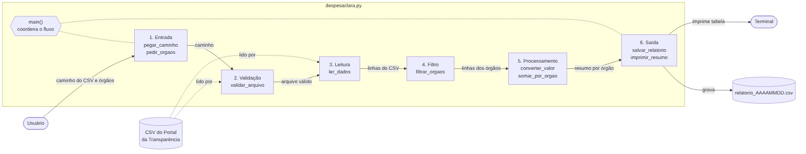

# Sprint 3 - Arquitetura do DespesaClara

O sistema é um *pipeline*: cada etapa recebe o resultado da anterior. Todas as
etapas ficam em `despesaclara.py`, e a função `main()` só coordena a ordem.

(O código-fonte do diagrama está em `arquitetura.mmd`.)

## Componentes, responsabilidades e comunicação

| # | Componente | Funções | Responsabilidade | Recebe | Entrega |
|---|------------|---------|------------------|--------|---------|
| 1 | Entrada | `pegar_caminho`, `pedir_orgaos` | Obter do usuário o caminho do CSV e a lista de órgãos | argumentos / terminal | caminho (str), lista de órgãos |
| 2 | Validação | `validar_arquivo` | Conferir extensão `.csv` e colunas obrigatórias | caminho | `True` ou erro `ArquivoInvalido` |
| 3 | Leitura | `ler_dados` | Ler o CSV (UTF-8 ou Latin-1, separador `;`) | caminho | lista de linhas (dicionários) |
| 4 | Filtro | `filtrar_orgaos` | Manter só os órgãos pedidos (nome ou código, sem diferenciar maiúsculas); avisar os não encontrados; perguntar se não houver filtro | linhas + lista de órgãos | linhas filtradas ou erro `OperacaoCancelada` |
| 5 | Processamento | `converter_valor`, `somar_por_orgao` | Converter valores `1.234,56` para `Decimal`, tratar vazio como `0.00` e somar empenho, liquidação e pagamento **separadamente** por órgão | linhas filtradas | resumo `{órgão: {empenhado, liquidado, pago}}` |
| 6 | Saída | `salvar_relatorio`, `imprimir_resumo`, `formatar_moeda`, `abreviar_nome` | Gravar `relatorio_<data>.csv` (separador `;`) e mostrar a tabela com total no terminal | resumo | arquivo CSV + texto no terminal |

Comunicação: chamadas de função em sequência, passando listas e dicionários
simples. Erros esperados (`ArquivoInvalido`, `OperacaoCancelada`) sobem até o
`main()`, que mostra a mensagem e encerra com código 1.

## Decisões

- **Pipeline em etapas pequenas:** cada etapa pode ser testada sozinha (os
  testes chamam as funções diretamente, sem precisar do terminal).
- **`Decimal` em vez de `float`:** dinheiro precisa de duas casas exatas.
- **Três totais separados:** empenho, liquidação e pagamento nunca viram um
  "gasto" único (ver pesquisa da Sprint 1).
- **Um arquivo só:** a entrega final pede dois `.py` (código + testes).
